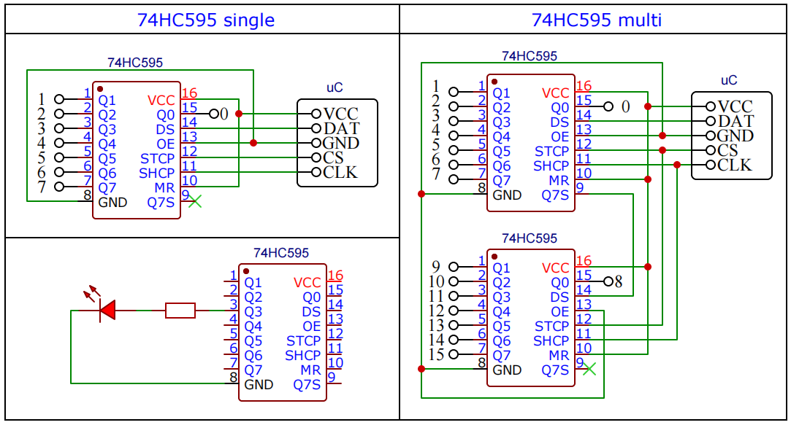
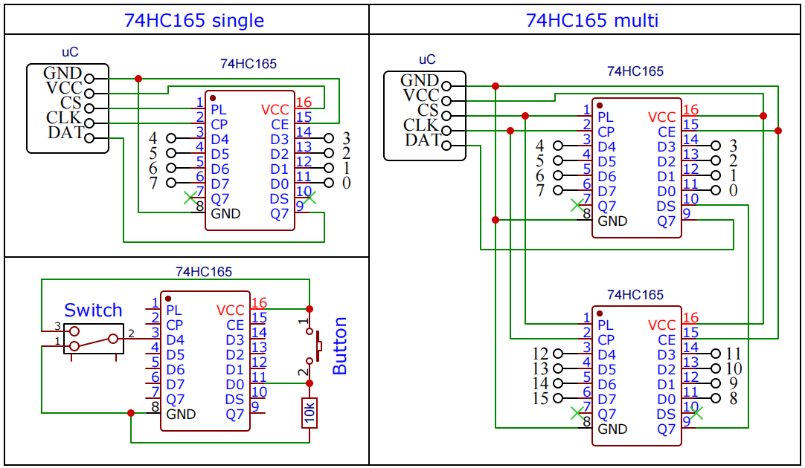
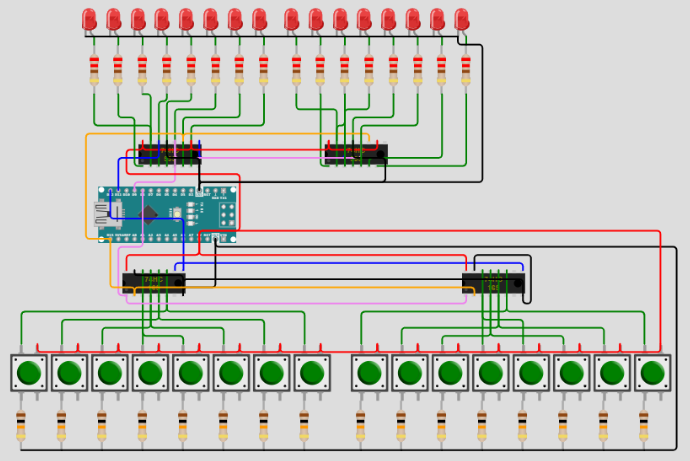

This is an automatic translation and may be incorrect in some places. See the source README and examples for authoritative information.

[](https://github.com/GyverLibs/GyverShift/releases/latest/download/GyverShift.zip)
[](https://registry.platformio.org/libraries/gyverlibs/GyverShift)
[](https://alexgyver.ru/)
[](https://alexgyver.ru/support_alex/)
[](https://github-com.translate.goog/GyverLibs/GyverShift?_x_tr_sl=ru&_x_tr_tl=en)  

[](https://t.me/GyverLibs)

# GyverShift
Library for easy work with shift registers, increasing the number of pins of Arduino
- Out - 74HC595
- Entrance - 74HC165
- Buffering values bitwise into a buffer
- Fast bit-bang data transfer based on GyverIO – ten times faster than standard shift functions
- Work through hardware SPI
- Convenient treatment of pins as an array

### Compatibility
Compatible with all Arduino platforms (Arduino features are used)

## Contents
- [Connection](#wiring)
- [Use of use](#usage)
- [Example](#example)
- [Versions](#versions)
- [Installation](#install)
- [Bugs and feedback](#feedback)

<a id="wiring"></a>

## Connection
### 74HC595


### 74HC165


> Note: The pin must be either tightened or have a single LOW/HIGH signal.

> [!WARNING]
> To use the 74HC165 together with other chips on the SPI bus, you need to connect its MISO (Q7 output) to the MISO bus via a 2-10k resistor, since the 74HC165 cannot disconnect from the bus and does not have a classic CS or CE pin.

### Online example
  

Combined example (165 at the entrance controls 595 at the exit) can be poked[wokwi](https://wokwi.com/projects/385985356026270721)

<a id="usage"></a>
## Use of use

### Initialization
```cpp
// bit-bang (any pins)
#include <GyverShift.h>
GyverShift<OUTPUT, кол-во чипов> reg(CS, DAT, CLK); // output (HC595)
GyverShift<INPUT, кол-во чипов> reg(CS, DAT, CLK);  // entrance (HC165)

// bit-bang (any pins) - pins in the template (higher transfer speed on AVR)
#include <GyverShiftT.h>
GyverShiftT<OUTPUT, кол-во чипов, CS, DAT, CLK> reg; // output (HC595)
GyverShiftT<INPUT, кол-во чипов, CS, DAT, CLK> reg;  // entrance (HC165)

// hardware SPI
#include <GyverShiftSPI.h>
GyverShiftSPI<OUTPUT, кол-во чипов, clock = 4000000> reg(CS); // output (HC595)
GyverShiftSPI<INPUT, кол-во чипов, clock = 4000000> reg(CS);  // entrance (HC165)

// spi
// OUTPUT: DAT->MOSI
// INPUT: DAT->MISO
```

### Class description
```cpp
// ===============================
// Update the pins. Return true if there was a buffer change (for INPUT mode)
bool update();

// True was a buffer change (for INPUT mode). He'll throw himself into falsehood.
bool changed();

// buffering
uint8_t buffer[];

// ===============================
// inherited from BitPack
void set(uint16_t num);                 // set up
void clear(uint16_t num);               // drop off
void toggle(uint16_t num);              // switch off
void write(uint16_t num, bool state);   // write down
bool read(uint16_t num);                // read
void setAll();                          // set up
void clearAll();                        // drop off
uint16_t amount();                      // pinage
uint16_t size();                        // byte size

// ===============================
// Defile settings (call before connecting the library)
#define GSHIFTT_DELAY 5     // GyverShiftT - set bitbang latency (reduce transmission speed), microseconds
#define GSHIFT_DELAY 5      // GyverShift - set bitbang latency (reduce transfer speed), microseconds
#define GSHIFTSPI_DELAY 5   // GyverShiftSPI - set bitbang pin CS latency, microseconds
```

### Read-write
Library inherits[BitPack](https://github.com/GyverLibs/BitPack)Access to the buffer as an array and other tools. Buffer bitwise and packed in bytes, the chip just has 8 inputs and outputs. To update the state of outputs and read inputs need to call`update()`.
```cpp
// OUTPUT
reg[0] = 1;       // pin
reg[1] = 0;       // switch off
reg.write(2, 1);  // pin
reg.set(3);       // pin 3
reg.clear(4);     // switch off
//reg.setAll(); // include
reg.update();     // refresh


// INPUT
reg.update();     // pin
// buffer
Serial.println(reg[0]);
Serial.println(reg.read(1));
bool p2 = reg[2];
bool p3 = reg.read(3);
```

<a id="example"></a>
## Example
For more examples see **examples**!

```cpp
#include <GyverShift.h>
// 74hc595
#define CLK_595 13
#define CS_595 9
#define DAT_595 11

GyverShift<OUTPUT, 2> outp(CS_595, DAT_595, CLK_595);
void setup() {
    outp.write(0, 1);
    outp.write(1, 1);
    outp[7] = 1;
    outp[8] = 1;
    outp[14] = 1;
    outp.update();
}
```

<a id="versions"></a>

## Versions
- v1.0
- v1.1 - added GyverShiftT class with pins in the template
- v1.1.1 - corrected GyverShiftT class name

<a id="install"></a>
## Installation
- Libraries are required for work[BitPack](https://github.com/GyverLibs/BitPack)and[GyverIO](https://github.com/GyverLibs/GyverIO)
- The library can be found under the name **GyverShift** and installed through the library manager in:
    - Arduino IDE
    - Arduino IDE v2
    - PlatformIO
- [Download the library](https://github.com/GyverLibs/GyverShift/archive/refs/heads/main.zip).zip archive for manual installation:
    - Unpack and put in *C:\Program Files (x86)\Arduino\libraries* (Windows x64)
    - Unpack and put in *C:\Program Files\Arduino\libraries* (Windows x32)
    - Unpack and put in *Documents/Arduino/libraries/ *
    - (Arduino IDE) Automatic installation from .zip: *Sketch/Connect library/Add .ZIP library...* and specify downloaded archive
- Read more detailed instructions for installing libraries[here](https://alexgyver.ru/arduino-first/#%D0%A3%D1%81%D1%82%D0%B0%D0%BD%D0%BE%D0%B2%D0%BA%D0%B0_%D0%B1%D0%B8%D0%B1%D0%BB%D0%B8%D0%BE%D1%82%D0%B5%D0%BA)
### Update
- I recommend always updating the library: new versions fix errors and bugs, as well as optimize and add new features.
- Through the library manager IDE: find the library as when installing and click "Update"
- Manually: **Delete the folder with the old version** and then put the new one in its place. “Replacement” can not be done: sometimes new versions delete files that will remain when replaced and can lead to errors!

<a id="feedback"></a>
## Bugs and feedback
If you find bugs, create **Issue**, or better write to the mail immediately.[alex@alexgyver.ru](mailto:alex@alexgyver.ru)  
The library is open for revision and your **Pull Requests*!

When reporting bugs or incorrect work of the library, it is necessary to specify:
- Library version
- What is used by the IC
- SDK version (for ESP)
- Arduino IDE version
- Are embedded examples that use features and designs that cause bugs in your code working correctly?
- What code was downloaded, what work was expected from it and how it works in reality
- Ideally, attach the minimum code in which the bug is observed. Not a canvas of a thousand lines, but a minimum code.
